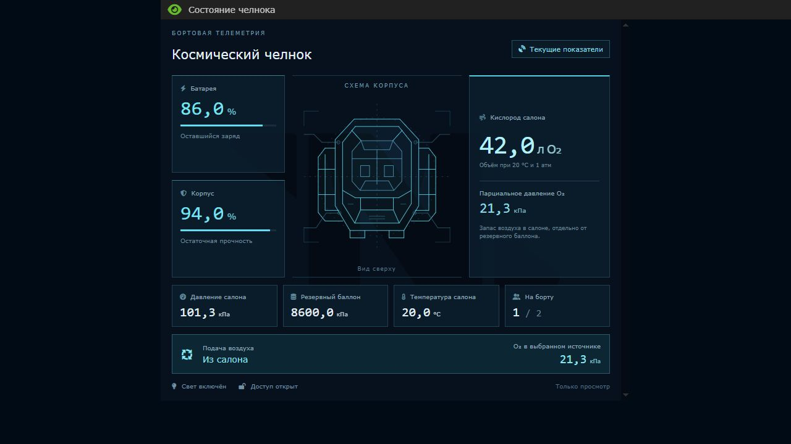

# Космические поды

Адаптация подов SS220 Paradise для PrimeDream. Источник зафиксирован на
`38015e8f1ad32d0812874a7b06090d7d09a5888c`; авторство и лицензии — в
[CREDITS.md](CREDITS.md), оригинальные пути и хэши — в [ASSETS.json](ASSETS.json).

## Профессия

**Челнок-инженер / Spacepod Technician**: один слот инженерного отдела, начальник —
старший инженер. Инженерные гарнитура, PDA, инструменты и ID. Производство подов
доступно через отдельный инженерный фабрикатор. На картах без своего landmark используется
штатная точка появления станционного инженера; для мастерской предусмотрен
`/obj/effect/landmark/start/spacepod_technician`.

На сервере с устаревшим `config/jobs.txt` добавьте `Spacepod Technician=1,1`.
При использовании `jobconfig.toml` отсутствие новой секции сохраняет один слот из кода.

## Изготовление

В фабрикаторе подов есть категория **Космические челноки**. Каркас, ядро, плата,
гражданская броня, сиденье, вспомогательный отсек, замок, ключ, краска и плата консоли
доступны с начала раунда. Грузовые и шахтёрские модули, маяк и сканер открываются через
исследование «Оборудование космических челноков». Вооружение и продвинутые системы
находятся в следующих узлах исследований.

Фабрикатор `/obj/machinery/mecha_part_fabricator/spacepod` имеет инженерный доступ,
штатные очередь, загрузку материалов и улучшение деталей. Он печатает только подовые
детали и оборудование; обычный экзофабрикатор обслуживает мехов и киборгов.
Фабрикатор установлен в инженерном отделе всех восьми станционных карт ротации:
Delta, IceBox, Meta, Tram, Nebula, Cyberiad, Kilo и Wawa. Дополнительные машины
можно построить из платы, доступной инженерному принтеру плат с начала раунда.

Четыре разные секции каркаса нужно расположить квадратом 2×2, повернуть в одном
направлении и закрепить ключом. Их соединение 10 стержнями создаёт каркас. Затем:

1. Четыре кабеля → отвёртка.
2. Главная плата → отвёртка.
3. Ядро → гаечный ключ.
4. Пять железных листов → гаечный ключ → сварка.
5. Гражданская броня → гаечный ключ → сварка.

Стадии обратимы; описание каркаса указывает нужный инструмент. Плата, ядро и броня
возвращаются исходными предметами. Срезанная проводка не возвращается, как у донора.
Строительство использует местный construction component без навыков Paradise.
Материальные цены пересчитаны в местные единицы с сохранением количества листов.

## Эксплуатация

Перетащите персонажа на под для посадки. Первый пилот управляет движением; второму
человеку нужен модуль пассажирского кресла. Кнопки действий позволяют выйти,
переключить подачу воздуха и свет, стрелять и управлять дополнительными системами.
Управление поворотом использует штатную клавишу поворота персонажа.

Кнопка **VIEW STATS / «Состояние челнока»** слева от Eject открывает бортовой монитор
для пилота и пассажира. Постоянных надписей внизу экрана нет. В отдельном окне показаны
заряд, прочность корпуса, запас и давление O₂, давление и температура салона,
резервный баллон и выбранный источник воздуха. Кислород указан в литрах при 20 °C
и 1 атмосфере и как парциальное давление в кПа. Голубая схема корпуса и показатели
выделяются розовым при критических повреждениях, низком заряде или нехватке O₂.
Окно обновляется штатным TGUI и закрывается при выходе из пода; управление подом
через монитор не предусмотрено. «Дополнительные системы» остаются отдельной кнопкой.

Внутри есть конечный запас воздуха и сменная батарея. Источник дыхания по умолчанию —
кабина с внутренним баллоном; отключение подачи переключает дыхание на внешнюю среду.
В космосе двигатели удерживают положение. Для перемещения нужны свободные клетки
под всем корпусом 2×2. Сварка ремонтирует корпус; лом открывает технический люк.
При открытом люке модули и батарея устанавливаются предметом и снимаются через
нажатие пустой рукой. Сначала высадите человека из снимаемого кресла.

Для замены резервного баллона выйдите из пода и выключите боевой режим. Откройте
технический люк ломом, нажмите на под пустой рукой и выберите баллон: он появится
на плитке под вами, если там нет других плотных объектов. Подготовьте новый большой атмосферный баллон с воздухом
(`/obj/machinery/portable_atmospherics/canister/air`): закройте его вентиль и
отсоедините от атмосферного коннектора. Подтяните его к поду и перетащите на под
с открытым люком.
После установки закройте люк ломом. Маленькие ручные баллоны `/obj/item/tank`
для этого не подходят. Снятый большой баллон можно штатно заправить на станции:
поставьте его на атмосферный коннектор с подачей воздуха и подключите гаечным ключом;
после заправки тем же ключом отсоедините его перед возвратом в под.

Сама замена баллона сохраняет газ в салоне. Во внутреннем режиме встроенная система
жизнеобеспечения автоматически удаляет CO₂ наружу. При низком парциальном давлении O₂
она обменивает часть атмосферы салона на свежий воздух из резервного баллона, если
в нём выше доля кислорода. Запас баллона конечный; отдельной кнопки очистки нет.
Для работы нужны заряженная батарея и отсутствие блокировки от ЭМИ или аварии ядра.
Без резервного баллона фильтр может продолжать удалять CO₂, но новый кислород
не появится. Система не создаёт O₂ и не гарантирует пригодный для дыхания состав
при неверном газе в резерве или исчерпанном запасе кислорода. Проверяйте в мониторе
запас O₂ салона и кислород в выбранном источнике воздуха.

Штатная батарея высокой ёмкости хранит **100 кДж**. Шаг расходует **10 Дж**, даже если путь оказался занят;
поворот на месте энергии не требует. Вооружение расходует **2,5–18 кДж за активацию**
в зависимости от модуля: расход списывается за весь залп, а не за каждый снаряд.
Свет, обычный регулятор давления и регулятор температуры сейчас не расходуют заряд
батареи. Система жизнеобеспечения потребляет **5 Вт только во время очистки CO₂
или обмена воздуха**; в простое этот расход отсутствует.

Звук двигателя слышен в кабине во время полёта и обрывается при завершении движения,
столкновении, потере питания, ЭМИ или выходе пилота. После собственного взрыва либо
уничтожения сильным внешним взрывом остаются механические обломки по площади корпуса.
Обломки сохраняются и в открытом космосе; обычное админское удаление их не создаёт.

Заготовку ключа применяют к снятому замку. После его установки ключ открывает и
закрывает под снаружи, а пилот переключает блокировку изнутри. Ящик или рудный ящик
загружается перетаскиванием на под с соответствующим модулем. Рудный модуль собирает
руду под всем корпусом. Снятие и уничтожение грузового модуля выгружает содержимое.

Закрытый ящик грузится снаружи за четыре секунды; под должен быть разблокирован.
Для выгрузки пилот выбирает «Дополнительные системы → Сбросить груз».
Снаружи достаточно нажать пустой рукой на разблокированный под с закрытым техническим
люком. Если установлены оба грузовых отсека, появится выбор между малым отсеком
и выгрузкой ящика. Груз появляется на свободной клетке рядом с корпусом 2×2;
если места нет, он остаётся внутри с сообщением об ошибке.

Вспомогательный отсек занимает слот пассажирского кресла. Предметом нажмите на под,
чтобы положить вещь; пустой рукой снаружи откройте штатный инвентарь и заберите её
обычным кликом. Нужны разблокированный под, закрытый люк и выключенный боевой режим.
Из кабины «Дополнительные системы → Проверить под сиденьем» показывает список вещей:
выбранный предмет выгружается рядом, после выхода его можно подобрать. Руки пилота
остаются заблокированными штатной системой транспорта. Замок, открытие люка и снятие
модуля закрывают окно внешнего доступа.

Маяк отслеживается собираемой консолью `/obj/machinery/computer/podtracker`;
доступ нужен инженерный либо робототехнический. Базовый сканер ищет астероиды,
усовершенствованный — руины текущего сектора.

Доступны варианты `/obj/vehicle/sealed/spacepod/civilian`, `/sec`, `/syndi`, `/random`
и `/civilian/damaged`. На существующие карты готовые поды и ангары не расставляются.
Роль может производить поды через инженерный фабрикатор. Для отдельного ангара
потребуются выход в космос шириной 2 клетки и место для корпуса 2×2.

## Проверка

Последний результат: **96/96 групп PASS**, обычная сборка — 0 ошибок и 0 предупреждений.
Подробности и границы проверки: [VALIDATION.md](VALIDATION.md).

Сначала выполните обычную сборку `bin/build.cmd`, чтобы подготовить TGUI, переводы
и behavior trees. Из корня репозитория: `tools/spacepods/test-spacepods.ps1`.
Скрипт компилирует focused tests, запускает изолированную MetaStation и сохраняет
логи и JSON в `tmp/spacepods-*`. Тесты проверяют сборку, посадку, дыхание, движение,
модули, оружие, груз, роль, доступы, консоль и исследования. Полный клиентский раунд
остаётся отдельной ручной проверкой.

Для ручного прогона запустите `tools/spacepods/start-local.ps1`. Подключение: `byond://127.0.0.1:1345`.
Сервер использует отдельные настройки, сохранения и журналы в `tmp/local-spacepods`.
Повторный запуск подключается к уже работающему стенду; для пересборки сначала
используйте `tools/spacepods/stop-local.ps1`.

По умолчанию запускается Cyberiad. Для другой карты передайте, например,
`-Map metastation`; перед сменой карты остановите предыдущую локалку.
В лобби выберите **Челнок-инженер** в инженерном отделе и готовность к игре.
Только на стенде ограничение стажа снято. Роль появляется в инженерке станции;
подготовленный «Локальный ангар подов» доступен через админский переход в область.
Там стоят гражданский, охранный и повреждённый поды, консоль слежения и фабрикатор подов.
Рядом с гражданским находится «Тестовый грузовой под» с двумя установленными отсеками,
загруженным ящиком и фонариком в малом отсеке для проверки открытия и выгрузки.
Рядом с фабрикатором находятся два запасных больших баллона с воздухом для проверки
замены; для заправки используйте штатный атмосферный коннектор станции.
Проходное поле удерживает воздух ангара; за его границей — вакуум без гравитации.
Проверьте посадку перетаскиванием персонажа на под, полёт стрелками, поворот
Alt+направление без движения, свет, стрельбу, консоль и восстановление рук после выхода.
